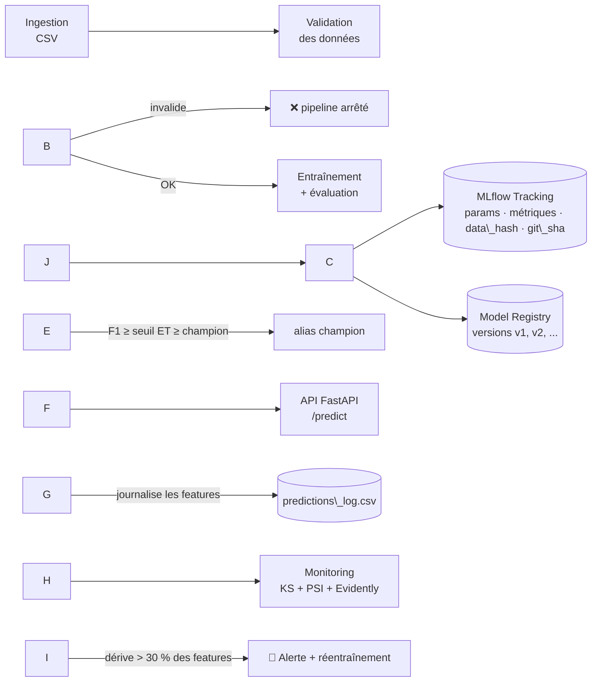

# MLOps Platform — cycle de vie complet d'un modèle de ML, du code à la production

**Stack :** Python · Scikit-learn · MLflow · FastAPI · Docker · GitHub Actions · Evidently

Projet de bout en bout qui industrialise un modèle de classification : pipeline reproductible,
suivi des expériences et versionnage des modèles, CI/CD, déploiement d'une API, puis surveillance
en production avec détection de dérive et réentraînement automatique.

> Le jeu de données (Breast Cancer Wisconsin) est fourni avec scikit-learn : \*\*aucun téléchargement\*\*.
> Pour utiliser vos données, remplacez `data/raw/dataset.csv` (cible binaire `target` + features numériques)
> et adaptez `params.yaml`.

\---

## 1\. Architecture



## 2\. Structure du projet

```
mlops-platform/
├── params.yaml                  # TOUS les paramètres (données, modèle, seuils) — versionnés avec le code
├── src/mlops\_platform/
│   ├── ingestion.py             # génération/chargement du dataset, hash SHA-256, split stratifié
│   ├── validation.py            # contrôles qualité (schéma, nulls, cible binaire, infinis...)
│   ├── modeling.py              # pipeline sklearn (StandardScaler + RandomForest/LogReg) + métriques
│   ├── registry.py              # MLflow : expérience, Model Registry, alias « champion », porte qualité
│   ├── train.py                 # orchestre ingestion → validation → entraînement → registry
│   ├── drift.py                 # détection de dérive (KS + PSI) + rapport HTML Evidently
│   ├── monitor.py               # dérive → alerte (log + webhook) → réentraînement
│   ├── simulate.py              # fausses données de production, avec/sans dérive (démo)
│   ├── cli.py                   # commandes : prepare-data | train | simulate-drift | monitor
│   └── api/main.py              # FastAPI : /health /model-info /predict /reload
├── tests/                       # Pytest : validation, modèle, dérive, intégration MLflow, API
├── Dockerfile                   # image non-root, couches de cache optimisées, HEALTHCHECK
├── docker-compose.yml           # trainer → api + mlflow-ui (+ monitor à la demande)
├── .github/workflows/
│   ├── ci.yml                   # ruff + pytest + smoke test + build Docker (+ push GHCR sur main)
│   └── retrain.yml              # boucle surveillance → réentraînement (manuel + hebdomadaire)
├── Makefile                     # raccourcis : make data / train / test / serve ...
└── requirements\*.txt
```

## 3\. Démarrage rapide (local)

Prérequis : Python 3.10+ (testé sur 3.13 ; l'image Docker utilise 3.11).

```bash
python -m venv .venv \&\& source .venv/bin/activate     # Windows : .venv\\Scripts\\activate
make install            # ou : pip install -r requirements-dev.txt

make data               # génère data/raw/dataset.csv
make train              # entraîne, évalue, enregistre dans MLflow, promeut le champion
make test               # lance les tests
make serve              # API sur http://localhost:8000/docs  (Swagger interactif)
make mlflow-ui          # interface MLflow sur http://localhost:5000
```

> Le `Makefile` définit `PYTHONPATH=src` pour vous. Sous Windows sans `make`, exécutez les commandes des
> cibles à la main depuis la racine du projet, après `set PYTHONPATH=src` (PowerShell : `$env:PYTHONPATH="src"`),
> par exemple `python -m mlops\_platform.cli train`.

## 4\. Démarrage avec Docker

```bash
docker compose up --build
```

Entraîne le modèle (service `trainer`), puis démarre l'API (`:8000`) et l'interface MLflow (`:5000`).
Les données, la base MLflow et les rapports vivent dans le volume partagé `mlops\_data`.

## 5\. Scénario de démo complet (à montrer en entretien)

```bash
# 1. Un modèle est entraîné et promu
make data train

# 2. L'API le sert
make serve                                   # dans un autre terminal
python - <<'EOF'
import json, urllib.request, pandas as pd
rows = pd.read\_csv("data/processed/reference.csv").head(3).to\_dict(orient="records")
req = urllib.request.Request("http://localhost:8000/predict",
      data=json.dumps({"instances": rows}).encode(),
      headers={"Content-Type": "application/json"})
print(urllib.request.urlopen(req).read().decode())
EOF

# 3. Les données de production dérivent (simulation) → alerte → réentraînement
make simulate-drift
make monitor                                 # détecte 15/30 features en dérive, réentraîne → modèle v2

# 4. L'API prend le nouveau champion sans redémarrer
curl -X POST http://localhost:8000/reload
```

Ouvrez ensuite MLflow (`make mlflow-ui`) : vous voyez les deux versions du modèle, leurs métriques,
le `data\_hash`, le `git\_sha` et le tag `promotion\_decision`. Le rapport de dérive est dans
`reports/drift\_report.json` (et `drift\_report.html` si Evidently est installé).

Pour comparer, `python -m mlops\_platform.cli simulate-drift --no-drift` génère des données **sans**
dérive : la surveillance ne déclenche rien.

Avec Docker : `docker compose --profile tools run --rm monitor` (nécessite des données de production,
donc d'abord des appels à `/predict`, ≥ 30 observations, ou un CSV passé via `--current`).

## 6\. Ce que fait chaque brique

### Pipeline reproductible

* **Ingestion** : chargement du CSV, hash SHA-256 du contenu (tracé dans MLflow), split stratifié à graine fixe.
* **Validation** (`validation.py`) : nombre de lignes minimum, cible binaire avec les 2 classes, features
numériques, taux de valeurs manquantes, valeurs infinies ; avertissements sur features constantes et doublons.
Si une erreur est détectée, **le pipeline s'arrête avant l'entraînement**.
* **Entraînement/évaluation** : pipeline sklearn (`StandardScaler` + modèle), validation croisée (F1), puis
accuracy / precision / recall / F1 / ROC-AUC sur le jeu de test.
* **Reproductibilité** : paramètres dans `params.yaml`, graine fixe, `n\_jobs=1` (le parallélisme rendait les
probabilités non reproductibles bit à bit), `data\_hash` + `git\_sha` tracés dans chaque run.

### Suivi des expériences et Model Registry (MLflow)

* Chaque entraînement = un *run* (paramètres, métriques, modèle avec signature et exemple d'entrée).
* Chaque modèle est enregistré comme nouvelle **version** dans le Model Registry.
* **Porte qualité** : une version n'obtient l'alias `champion` que si `F1 ≥ min\_f1` (params.yaml) **et**
`F1 ≥` celui du champion actuel. Sinon la décision est tracée dans le tag `promotion\_decision`
(`rejected\_quality\_gate` ou `kept\_current\_champion`). L'API sert toujours l'alias `champion`.
* On utilise les **alias** (`models:/nom@champion`), pas les « stages » MLflow, dépréciés.

### CI/CD (GitHub Actions)

`ci.yml`, à chaque push/PR :

1. contrôle qualité du code (`ruff check` + `ruff format --check`) ;
2. tests Pytest avec couverture ;
3. smoke test de bout en bout (données → entraînement → registry) ;
4. build de l'image Docker (cache GitHub Actions) + test de l'image ;
5. sur `main` uniquement : push de l'image sur GitHub Container Registry (`ghcr.io`).

`retrain.yml` rejoue la boucle surveillance → réentraînement (déclenchement manuel ou chaque lundi)
et publie les rapports de dérive en artefact. Secret optionnel : `ALERT\_WEBHOOK\_URL`.

### Surveillance en production

* L'API journalise les features de chaque requête dans `predictions\_log.csv`.
* `monitor` compare ces données à la **référence** (features d'entraînement) feature par feature :
test de Kolmogorov-Smirnov + PSI. Une feature dérive si `p < 0.05` **et** `PSI ≥ 0.2` ;
le dataset est en dérive si **> 30 %** des features dérivent (seuils dans `params.yaml`).
* Combiner KS et PSI évite les fausses alertes : sur de gros volumes, KS seul détecte des écarts minuscules.
* En cas de dérive : alerte (log + webhook JSON Slack/Mattermost si `ALERT\_WEBHOOK\_URL` est défini),
puis réentraînement si `--retrain`. Un rapport HTML **Evidently** est généré en plus pour l'analyse visuelle.

## 7\. Mettre le projet sur GitHub

```bash
git init \&\& git add . \&\& git commit -m "Initial commit: MLOps platform"
git branch -M main
git remote add origin https://github.com/<votre-compte>/mlops-platform.git
git push -u origin main
```

Dans l'onglet **Actions**, le workflow `CI` se lance tout seul. Ajoutez le badge dans ce README :
`!\[CI](https://github.com/<votre-compte>/mlops-platform/actions/workflows/ci.yml/badge.svg)`.
Pour que le push sur GHCR fonctionne : *Settings → Actions → General → Workflow permissions → Read and write*.

## 8\. Limites connues et pistes d'amélioration

Soyez transparent là-dessus en entretien, c'est un point fort :

* **Données de production non étiquetées** : l'API ne connaît pas la vérité terrain. Le réentraînement
n'utilise donc de nouvelles données que si elles contiennent la colonne cible (c'est le cas du CSV simulé).
En vrai : brancher un flux d'étiquettes (retours métier) pour surveiller aussi la dérive de *performance*.
* **Comparaison au champion** : faite sur la métrique F1 de test de chaque run ; si le jeu de test change
(nouvelles données), la comparaison n'est qu'indicative. Piste : évaluer champion et challenger sur un
même jeu de référence figé.
* **Dérive limitée aux features** (pas de dérive de la cible/prédiction pour l'instant).
* **Pas d'orchestrateur** : `monitor` est lancé par cron/GitHub Actions. Piste : Airflow/Prefect.
* **MLflow en SQLite + fichiers** : suffisant pour un projet, à remplacer par PostgreSQL + S3/MinIO en équipe.
* **API** : pas d'authentification ni de métriques Prometheus. Pistes : clé d'API, `/metrics`, Grafana.

## IMPORTANT :

\## Démo


!\[Schéma du projet](docs/schema.png)


Résultats obtenus lors d'une exécution complète :


| Étape | Résultat |

|---|---|

| Entraînement v1 (Random Forest) | F1 = 0,966 · ROC-AUC = 0,994 · promu champion |

| Tests | 35 tests passent |

| Dérive simulée | 15 features sur 30 en dérive (seuil : 30 %) |

| Réentraînement automatique | v2 promue champion · F1 = 0,973 (jeu de test enrichi, donc non strictement comparable à la v1) |


L'API sert bien la v2 (`GET /model-info`) :


!\[Réponse de /model-info](docs/swagger-model-info.png)


\## Utilisation (Windows PowerShell)


Toujours depuis la racine du projet :


```powershell

python -m venv .venv

.\\.venv\\Scripts\\Activate.ps1

pip install -r requirements-dev.txt

$env:PYTHONPATH = "src"

```


| Étape | Commande | Ce que ça fait |

|---|---|---|

| Données | `python -m mlops\_platform.cli prepare-data` | Crée `data/raw/dataset.csv` |

| Entraînement | `python -m mlops\_platform.cli train` | Entraîne, enregistre dans MLflow, promeut le champion si F1 ≥ 0,90 |

| Tests | `python -m pytest` | Tests unitaires et d'intégration |

| API | `uvicorn mlops\_platform.api.main:app --app-dir src` | Swagger sur http://127.0.0.1:8000/docs |

| Interface MLflow | `mlflow ui --backend-store-uri sqlite:///mlflow\_data/mlflow.db` | http://localhost:5000 |

| Fausse dérive | `python -m mlops\_platform.cli simulate-drift` | Données de production décalées |

| Surveillance | `python -m mlops\_platform.cli monitor --current data/production/current.csv --retrain` | Détecte la dérive, réentraîne si besoin |

| Recharger l'API | `POST /reload` (dans Swagger) | L'API prend le nouveau champion |


\### Tester une prédiction

1\. Lance l'API, puis ouvre http://127.0.0.1:8000/docs.

2\. Ouvre `POST /predict` → \*\*Try it out\*\*.

3\. Envoie les 30 features (liste visible dans `GET /model-info`) sous la forme `{"instances": \[{...}]}`.

4\. La réponse contient la classe prédite (0 ou 1) et sa probabilité.

